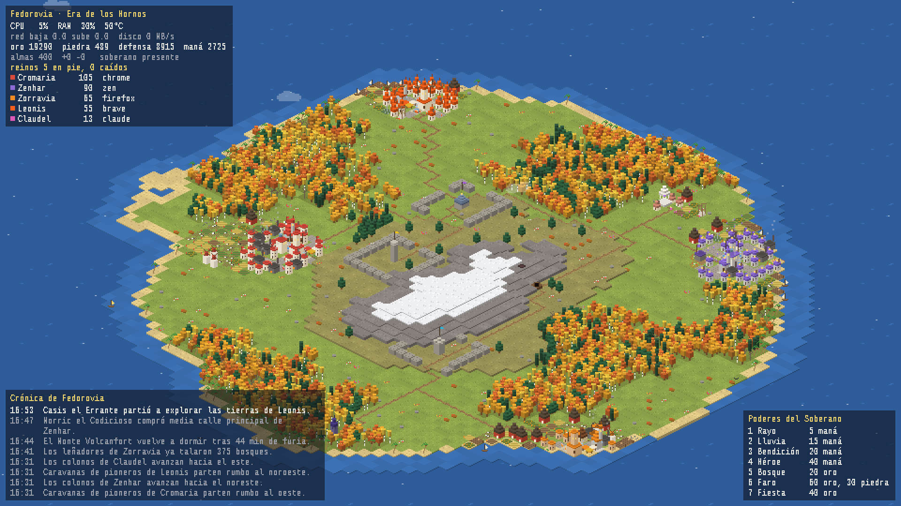

# kernel-kingdom — tu computadora es un reino

Live wallpaper / idle game en **pixel art isométrico para Linux (Wayland)**. El
mundo se construye con lo que tu máquina está haciendo de verdad: los
navegadores son imperios, los contenedores son ciudadelas, compilar desata
tormentas, y una crónica procedural lo va narrando todo.



*[Read in English](README.md)*

## Instalación (un comando)

```bash
curl -fsSL https://raw.githubusercontent.com/rsmedrano-cloud/kernel-kingdom/main/install.sh | bash
```

Instala en `~/.local/share/kernel-kingdom`, deja el comando `~/.local/bin/kernel-kingdom`,
revisa tu sistema (`kernel-kingdom doctor`) y lo deja arrancando con la sesión
(`systemd --user`). Necesita GTK 4, gtk4-layer-shell y PyGObject de tu distro: si
falta algo, el instalador te muestra el comando exacto y se ofrece a correrlo
(en Fedora Atomic los agrega con `rpm-ostree`; reiniciás y lo volvés a correr).

```bash
kernel-kingdom            # fondo de pantalla en todos los monitores, en segundo plano (la terminal queda libre)
kernel-kingdom window     # abre la ventana: zoom, poderes, reinos, crónica (también desde el lanzador)
kernel-kingdom stop       # detiene todo
kernel-kingdom story      # la historia del día (.md + .txt)
kernel-kingdom config     # tu config: ~/.config/kernel-kingdom/config.toml (language: auto, es, en)
kernel-kingdom uninstall
```

Después de instalar aparece **Kernel Kingdom** en el menú de aplicaciones. El mundo
corre como servicio en segundo plano: cerrar la ventana (o la terminal) nunca lo
detiene. En la ventana todo está en el botón **Menú** (arriba a la derecha): qué
paneles ver, los poderes del Soberano y las acciones del mundo; la crónica tiene su
propio botón **Descargar día**.

## Qué alimenta al mundo

| Tu sistema | En el reino |
|---|---|
| Navegador / app Electron (proceso raíz + hijos) | **Imperio**: la RAM decide cuánta tierra ocupa, los procesos hijos cuán denso es. Plan urbano: palacio, plaza, calles en grilla con pozos, mercado, taberna, templo, cuartel, biblioteca, talleres, cementerio; en las afueras granjas, pasturas con ovejas, aserraderos y muelles; atalayas en las fronteras disputadas. |
| Otras apps pesadas (Claude, terminales, Steam...) | **Aldeas** con un emblema: oráculo, herrería, arena, teatro, taberna, atalaya... |
| Dos reinos que se tocan | **Guerras con nombre** ("la Guerra de las Pestañas Huérfanas"): marchan ejércitos, los soldados chocan en el frente, los trebuchets bombardean ciudades, arden casas, se saquean capitales; después, tratados de paz. |
| Se reinicia un navegador | **Cambio de dinastía**: el monarca muere, abdica o lo derrocan. |
| Contenedores / bases de datos / daemons | **Ciudadelas, bóvedas y bastiones** con murallas que crecen con el uptime y escudos contra rayos. |
| Editores y compiladores | La **Academia**: un piso por editor, humo mientras compilás. |
| Pico de CPU | **Tormenta**; si dura, **erupción** del volcán. RAM llena: **niebla**. Swap: **peste**. CPU caliente: **incendios**. |
| Red / disco | **Flotas** mercantes y **caravanas**; las **minas** trabajan cuando trabaja el disco. |
| Sesiones SSH (`last`) | **Emisarios** de una tierra extranjera y su embajada en la costa. |
| Reinicios / kernel nuevo | Una nueva **Era**; un kernel nuevo es un dios nuevo. |
| Tu ausencia | "El Soberano se ausentó; el reino queda en vigilia." |
| Hora y fecha | Día y noche con ventanas encendidas, y **estaciones** según tu hemisferio. |

## Un mundo que cambia de forma durante el día

El tamaño del territorio sigue a la RAM, pero **dónde** vive cada reino no queda
quieto. Cada reino tiene un rumbo que gira lentamente durante el día: abandona
tierras por detrás y coloniza hacia adelante, así las fronteras migran por la
isla. Los vecinos van a la **guerra por ambición** unas cuantas veces por día ("por
una boda que salió mal"): marchan ejércitos, chocan las fronteras, lo conquistado
se arrasa, y si el atacante llega a la capital enemiga la **saquea y la corte huye**
a rearmar la ciudad en otro lado. El terreno también vive: los bosques avanzan,
los aserraderos los talan, los incendios dejan pradera, la lava se endurece en
colinas. Cada instalación tiene su propia isla.

## La historia del día

Cada entrada de la crónica se archiva por día. A medianoche (o cuando apretás `e`
en la ventana, o con `kernel-kingdom story`) se cuenta como un relato: título, lo
que pasó en números, lo más destacado, el día en cuatro partes y sus personajes.
Sale en Markdown y en texto plano, listo para leer en voz alta o pasarlo por una
voz sintética. [Ejemplo de un día completo](docs/story-example.es.md).

Además nacen **héroes** con nombre y carácter que hacen hazañas y mueren; los
templos fundan **religiones** con su deidad; el tesoro paga **monumentos**. Los
aldeanos tienen oficio y caminan por las calles al trabajo, al estilo WorldBox.

## En el escritorio se mira, en la ventana se juega

El fondo de pantalla es para mirar: los clics pasan al escritorio. Abrí
`kernel-kingdom window` para actuar:

- **Poderes del Soberano** (barra de poderes o teclas 1–7): **Rayo**, **Lluvia**,
  **Bendición**, **Héroe**, **Bosque**, **Faro**, **Fiesta**, pagados con lo que
  produce el reino (oro, piedra, maná, defensa; costos en `[powers]` de la config).
  Construir lleva gente y tiempo: obreros caminan desde la ciudad más cercana para
  levantar el faro, los druidas plantan el bosque casilla por casilla.
- **Todos los reinos, en pie o caídos**, en una lista con scroll; clic en uno y la
  cámara viaja a su capital.
- **La crónica entera**: la rueda la recorre hacia atrás, `c` la expande, RePág/AvPág.

El mapa también se mueve solo: **exploradores** que salen a lo salvaje y vuelven
con hallazgos, **ejércitos en columna** cuando estalla una guerra, y reinos grandes
que **sitian fortalezas** (si tenés defensa los muros resisten; si no, caen y hay
saqueo).

## Zoom

En modo ventana: rueda = zoom hacia el cursor, arrastrar = mover el mapa, doble
clic = ver la isla entera. Al acercar, los sprites se generan al doble de
resolución.

## Liviano

- Tope de 30 FPS; ~6 FPS cuando no pasa nada.
- Se dibuja a baja resolución y la GPU escala con filtro NEAREST.
- **Se pausa del todo** (0% CPU) cuando ventanas maximizadas, en pantalla completa
  o en mosaico tapan el fondo (COSMIC; en otros compositores sigue corriendo).
- Medido: ~1–3% de un núcleo visible, ~2% el daemon.

## Compatibilidad

| | |
|---|---|
| COSMIC | todo |
| Sway, Hyprland, KDE Plasma, niri, river | wallpaper (wlr-layer-shell); sin pausa automática todavía |
| GNOME, X11 | `kernel-kingdom window` |

Opcional: contar teclas (solo la cantidad, nunca cuáles) requiere que tu usuario
esté en el grupo `input`; si no, solo se detecta si estás presente o ausente.

## Cómo está hecho

El paquete de Python se llama `reino` (el proyecto nació en castellano).

```
reino/daemon   muestrea el sistema (psutil, `last`, idle de Wayland), simula el
               mundo y escribe state.json en $XDG_RUNTIME_DIR cada 2 s
reino/render   GTK 4 + gtk4-layer-shell; sprites pixel art procedurales (cairo),
               pintor isométrico, batallas e incendios, crónica, Menú
reino/wl.py    cliente Wayland mínimo en Python puro (cobertura de ventanas, idle)
reino/locales  todos los textos, castellano e inglés
```

El mundo vive en el daemon: el reino sigue evolucionando aunque el fondo esté
tapado. Tests: `python3 -m unittest discover -s tests`.

## Licencia

MIT
