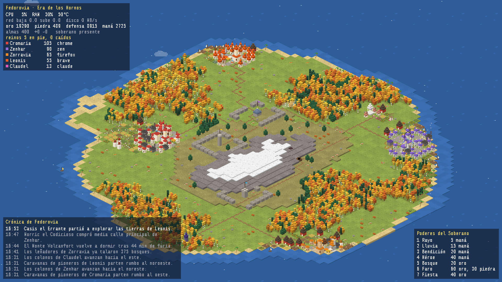
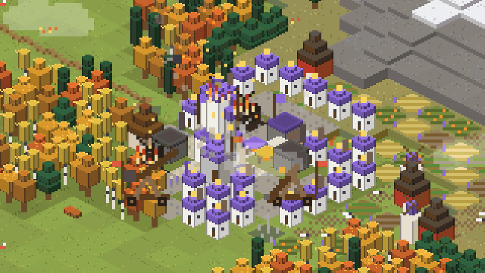
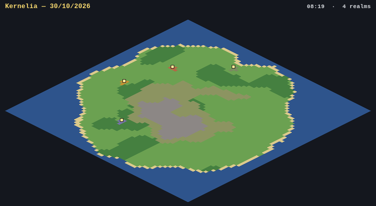
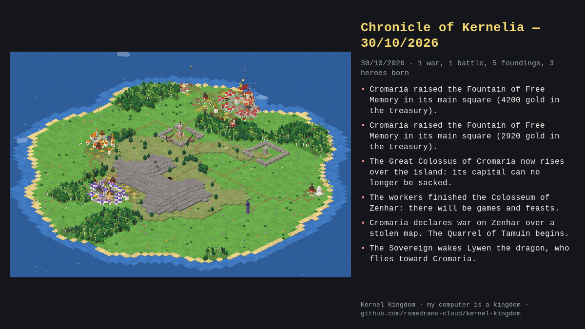
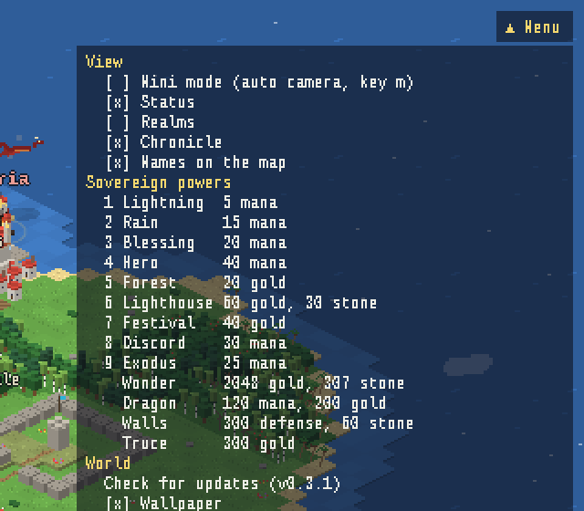
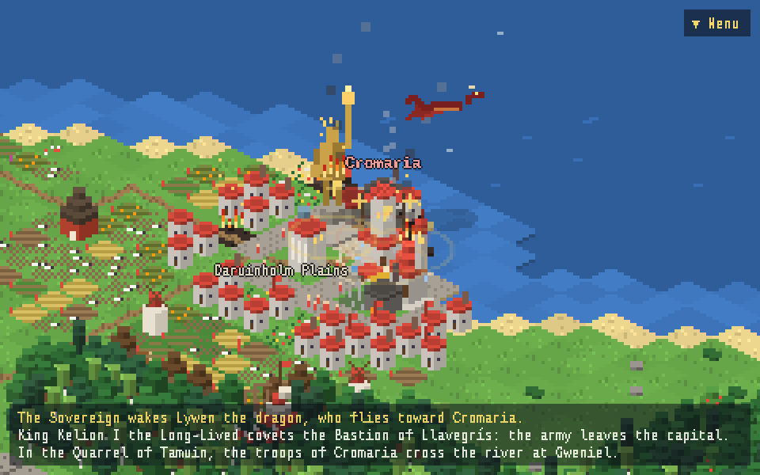

# kernel-kingdom — tu computadora es un reino

[](https://github.com/rsmedrano-cloud/kernel-kingdom/actions/workflows/tests.yml)

Live wallpaper / idle game en **pixel art isométrico para Linux (Wayland)**. El
mundo se construye con lo que tu máquina está haciendo de verdad: los
navegadores son imperios, los contenedores son ciudadelas, compilar desata
tormentas, y una crónica procedural lo va narrando todo.



*[Read in English](README.md)*

## Instalación (un comando)

```bash
curl -fsSL https://raw.githubusercontent.com/rsmedrano-cloud/kernel-kingdom/main/install.sh | bash
```

Instala en `~/.local/share/kernel-kingdom`, deja el comando `~/.local/bin/kernel-kingdom`,
revisa tu sistema (`kernel-kingdom doctor`) y lo deja arrancando con la sesión
(`systemd --user`). Necesita GTK 4, gtk4-layer-shell y PyGObject de tu distro: si
falta algo, el instalador te muestra el comando exacto y se ofrece a correrlo
(en Fedora Atomic los agrega con `rpm-ostree`; reiniciás y lo volvés a correr).

```bash
kernel-kingdom            # fondo de pantalla en todos los monitores, en segundo plano (la terminal queda libre)
kernel-kingdom window     # abre la ventana: zoom, poderes, reinos, crónica (también desde el lanzador)
kernel-kingdom window --mini  # ventanita con cámara automática, para un rincón de la pantalla
kernel-kingdom stop       # detiene todo
kernel-kingdom story      # la historia del día (.md + .txt)
kernel-kingdom timelapse  # GIF de cómo se movieron las fronteras hoy
kernel-kingdom config     # tu config: ~/.config/kernel-kingdom/config.toml (el idioma también en Menú > Mundo)
kernel-kingdom update     # baja la última versión (tu mundo se conserva)
kernel-kingdom uninstall
```

Después de instalar aparece **Kernel Kingdom** en el menú de aplicaciones. El mundo
corre como servicio en segundo plano: cerrar la ventana (o la terminal) nunca lo
detiene. En la ventana todo está en el botón **Menú** (arriba a la derecha): qué
paneles ver, los poderes del Soberano y las acciones del mundo; la crónica tiene sus
botones **Compartir** y **Descargar día**. Cuando sale una versión nueva, la ventana
te avisa y se actualiza sola desde **Menú > Mundo > Actualizar**. Los sucesos grandes
(guerras, saqueos, maravillas) también llegan como **notificaciones del escritorio**;
tocá una y la cámara viaja ahí (`[notify]` en la config).

**Compartí tu reino:** *Compartir* guarda una tarjeta con la isla y los titulares
del día, más el relato en Markdown, en `~/Imágenes/Kernel Kingdom` (sin IPs ni
nombres de usuario), y copia un texto corto al portapapeles. ¡Subí tus crónicas a
[Discussions › Show and tell](https://github.com/rsmedrano-cloud/kernel-kingdom/discussions/categories/show-and-tell)!

## Qué alimenta al mundo

| Tu sistema | En el reino |
|---|---|
| Navegador / app Electron (proceso raíz + hijos) | **Imperio**: la RAM decide cuánta tierra ocupa, los procesos hijos cuán denso es. Plan urbano: palacio, plaza, calles en grilla con pozos, mercado, taberna, templo, cuartel, biblioteca, talleres, cementerio; en las afueras granjas, pasturas con ovejas, aserraderos y muelles; atalayas en las fronteras disputadas. |
| Otras apps pesadas (Claude, terminales, Steam...) | **Aldeas** con un emblema: oráculo, herrería, arena, teatro, taberna, atalaya... |
| Dos reinos que se tocan | **Guerras con nombre** ("la Guerra de las Pestañas Huérfanas"): marchan ejércitos, los soldados chocan en el frente, los trebuchets bombardean ciudades, arden casas, se saquean capitales; después, tratados de paz. |
| Se reinicia un navegador | **Cambio de dinastía**: el monarca muere, abdica o lo derrocan. |
| Contenedores / bases de datos / daemons | **Ciudadelas, bóvedas y bastiones** con murallas que crecen con el uptime y escudos contra rayos. |
| Editores y compiladores | La **Academia**: un piso por editor, humo mientras compilás. |
| Pico de CPU | **Tormenta**; si dura, **erupción** del volcán. RAM llena: **niebla**. Swap: **peste**. CPU caliente: **incendios**. |
| Red / disco | **Flotas** mercantes y **caravanas**; las **minas** trabajan cuando trabaja el disco. |
| Sesiones SSH (`last`) | **Emisarios** de una tierra extranjera y su embajada en la costa. |
| Reinicios / kernel nuevo | Una nueva **Era**; un kernel nuevo es un dios nuevo. |
| Tu ausencia | "El Soberano se ausentó; el reino queda en vigilia." |
| Hora y fecha | Día y noche con ventanas encendidas, y **estaciones** según tu hemisferio. |

## Un mundo que cambia de forma durante el día

El tamaño del territorio sigue a la RAM, pero **dónde** vive cada reino no queda
quieto. Cada reino tiene un rumbo que gira lentamente durante el día: abandona
tierras por detrás y coloniza hacia adelante, así las fronteras migran por la
isla. Los vecinos van a la **guerra por ambición** unas cuantas veces por día ("por
una boda que salió mal"): marchan ejércitos, chocan las fronteras, lo conquistado
se arrasa, y si el atacante llega a la capital enemiga la **saquea y la corte huye**
a rearmar la ciudad en otro lado. El terreno también vive: los bosques avanzan,
los aserraderos los talan, los incendios dejan pradera, la lava se endurece en
colinas. Cada instalación tiene su propia isla.



Las fronteras de cada día, en un GIF (Menú > Mundo > Timelapse):



## Los Anales y el video del día

Cada día se vuelve un **capítulo de los Anales**, contado como lo haría un cronista:
abre con "Escuchad la crónica de…", sigue el día en actos (la madrugada, la mañana, la
tarde, el ocaso) y encadena causas y consecuencias: un reinicio apaga los bastiones,
los reinos se disuelven, otros renacen de las cenizas y "con el resurgir de los pueblos
estalló la ambición", con sus guerras, hasta la paz. Los sucesos se agrupan con sus
nombres ("Zenhar, Zorravia y Claudel se disolvieron, y sus gentes cargaron las carretas
hacia el exilio") y el capítulo se titula según lo más grande que pasó. El mundo tiene
memoria: cada capítulo sabe cuántos días lleva una guerra, que es la tercera entre los
mismos reinos, que tu isla durmió ocho horas (tu PC duerme, los servidores del lab nunca)
o que el reinicio de un servidor abrió una edad nueva en su isla. Los capítulos se juntan
en un libro (`kernel-kingdom annals`).

**El cronista** (opcional): un modelo de lenguaje toma ese borrador ordenado y lo escribe
en prosa épica: [ollama](https://ollama.com), o cualquier servidor compatible con la API de
OpenAI (llama.cpp, LM Studio, vLLM, o un servicio). `[bard]` en la config; los hechos del
día solo van a la dirección que pongas, y la clave se lee de una variable de entorno, nunca
de la config.

**El video del día** (Menú > Mundo, o `kernel-kingdom video`): el capítulo leído por una voz
local mientras la cámara va al reino, la isla o la región que nombra cada frase, con
subtítulos. La voz por defecto es [Kokoro](https://github.com/thewh1teagle/kokoro-onnx)
(natural, corre en tu CPU, se instala en su propio entorno); [Piper](https://github.com/rhasspy/piper)
es la opción liviana. Todo se baja una sola vez (pregunta antes) y después funciona sin
internet. Voces y motor: `[video]` en la config.

## La historia del día

Cada entrada de la crónica se archiva por día. A medianoche (o cuando apretás `e`
en la ventana, o con `kernel-kingdom story`) se cuenta como un relato: título, lo
que pasó en números, lo más destacado, el día en cuatro partes y sus personajes.
Sale en Markdown y en texto plano, listo para leer en voz alta o pasarlo por una
voz sintética. [Ejemplo de un día completo](docs/story-example.es.md).

Además nacen **héroes** con nombre y carácter que hacen hazañas y mueren; los
templos fundan **religiones** con su deidad; el tesoro paga **monumentos**. Los
aldeanos tienen oficio y caminan por las calles al trabajo, al estilo WorldBox.

**Compartir** convierte el día en una tarjeta (y un relato en Markdown), sin IPs ni
nombres de usuario:



## En el escritorio se mira, en la ventana se juega

El fondo de pantalla es para mirar: los clics pasan al escritorio. Abrí
`kernel-kingdom window` para actuar:

- **Poderes del Soberano** (Menú, o teclas 1–9): **Rayo**, **Lluvia**, **Bendición**,
  **Héroe**, **Bosque**, **Faro**, **Fiesta**, **Discordia**, **Éxodo**, y los caros:
  **Maravillas** (Coloso, Coliseo, Observatorio, Jardines Colgantes, cada una con su
  efecto y cada una más cara que la anterior), un **Dragón** que incendia una zona,
  **Murallas** para que una capital aguante casi todos los asedios y **Tregua** para
  terminar una guerra. Se pagan con lo que produce el reino (oro, piedra, maná,
  defensa; costos en `[powers]` de la config); un tesoro muy gordo atrae piratas.
  Construir lleva gente y tiempo: obreros caminan desde la ciudad más cercana para
  levantar el faro o la maravilla, los druidas plantan el bosque casilla por casilla.
- **Mientras no estabas**: si volvés a abrir la ventana después de un rato, te resume qué pasó.
- **Nombres en el mapa**: los reinos sobre su capital y las regiones de la isla
  (Bosque de Daris, Montes de Zandorholm, Valle de Ralo...). Las regiones son fijas,
  así que las batallas y expediciones de la crónica pasan en lugares que encontrás en
  el mapa. Se prenden y apagan en Menú > Ver (`[render] labels = true` para el fondo).
- **Modo mini** (`m` o Menú > Ver): sin paneles, la cámara viaja sola a donde pasan
  cosas (el dragón, una batalla, un asedio, una columna en marcha, un incendio, una
  maravilla en obra, lo último que pasó, o una recorrida tranquila por las capitales)
  con una tira de noticias abajo: tocá un titular y la cámara va ahí.
  Pensado para un rincón de otra pantalla (dejá la ventana flotante).
- **Timelapse del día** (Menú > Mundo): el mundo guarda una foto de las fronteras
  cada 10 minutos (~2 KB cada una) y arma un GIF con las guerras y migraciones del día.

También pasan cosas chicas: fuegos artificiales por los tratados de paz y las
maravillas, refugiados que dejan un reino caído, procesión de luto cuando muere un
monarca, bandadas, ballenas soplando cerca de la costa (y, muy de vez en cuando,
una serpiente marina), estrellas fugaces y auroras de noche, nieve en invierno.
- **Todos los reinos, en pie o caídos**, en una lista con scroll; clic en uno y la
  cámara viaja a su capital.
- **La crónica entera**: la rueda la recorre hacia atrás, `c` la expande, RePág/AvPág.

El mapa también se mueve solo: **exploradores** que salen a lo salvaje y vuelven
con hallazgos, **ejércitos en columna** cuando estalla una guerra, y reinos grandes
que **sitian fortalezas** (si tenés defensa los muros resisten; si no, caen y hay
saqueo).

| El Menú | Modo mini |
|---|---|
|  |  |

## Tu lab como archipiélago

Otras máquinas (un servidor en casa, una Raspberry…) emergen del mar como islas del
mismo mapa, alrededor de la tuya: las aplicaciones pesadas y los contenedores grandes
son ciudades, algunos contenedores y servicios más son fortalezas, la CPU de cada
máquina trae tormentas a su isla, y una máquina que se cae deja su isla en ruinas. Los
reinos de distintas máquinas **se hacen la guerra por mar**: zarpan galeras, desembarcan
en la costa enemiga y avanzan peleando, y cada tanto cruzan corsarios a saquear una costa.
Cada isla tiene el tamaño de la RAM de su máquina (la tuya sigue siendo la más grande).
Con zoom y arrastre navegás el archipiélago; las pestañas de arriba llevan la cámara a
cada isla y filtran la crónica: la primera es el archipiélago entero, con la historia de
todas las islas junta.

Se agregan desde **Menú > Mundo > Máquinas del lab…** (`usuario@máquina`; prueba la
conexión antes de agregarla). Es solo lectura y la app no instala ni abre nada en tu
red:

- La PC se conecta por SSH con una llave propia (`~/.ssh/kernel-kingdom`),
  reutilizando la conexión (ControlMaster). Nunca manda comandos.
- En cada máquina esa llave está restringida en `authorized_keys` a correr un único
  script fijo que imprime un reporte en JSON: [protocolo y campos](docs/remote-protocol.md).
- Los nombres de máquina, usuarios e IPs nunca llegan al mapa, la crónica ni a lo que
  compartís: cada isla tiene un nombre inventado, un contenedor o proceso que lleva el
  nombre de la máquina se renombra (`mihost-webui` → `webui`) y los errores muestran un
  motivo corto.

## Zoom

En modo ventana: rueda = zoom hacia el cursor, arrastrar = mover el mapa, doble
clic = ver la isla entera. Al acercar, los sprites se generan al doble de
resolución.

## Liviano

- Tope de 30 FPS; ~6 FPS cuando no pasa nada.
- Se dibuja a baja resolución y la GPU escala con filtro NEAREST.
- **Se pausa del todo** (0% CPU) cuando ventanas maximizadas, en pantalla completa
  o en mosaico tapan el fondo (COSMIC; en otros compositores sigue corriendo).
- Medido: ~1–3% de un núcleo visible, ~2% el daemon.

## Compatibilidad

| | |
|---|---|
| COSMIC | todo |
| Sway, Hyprland, KDE Plasma, niri, river | wallpaper (wlr-layer-shell); sin pausa automática todavía |
| GNOME, X11 | `kernel-kingdom window` |

Opcional: contar teclas (solo la cantidad, nunca cuáles) requiere que tu usuario
esté en el grupo `input`; si no, solo se detecta si estás presente o ausente.

## Cómo está hecho

El paquete de Python se llama `reino` (el proyecto nació en castellano).

```
reino/daemon   muestrea el sistema (psutil, `last`, idle de Wayland), simula el
               mundo y escribe state.json en $XDG_RUNTIME_DIR cada 2 s
reino/render   GTK 4 + gtk4-layer-shell; sprites pixel art procedurales (cairo),
               pintor isométrico, batallas e incendios, crónica, Menú
reino/wl.py    cliente Wayland mínimo en Python puro (cobertura de ventanas, idle)
reino/locales  todos los textos, castellano e inglés
```

El mundo vive en el daemon: el reino sigue evolucionando aunque el fondo esté
tapado. Tests: `python3 -m unittest discover -s tests`.

## Desarrollo

`main` es siempre la última versión estable: lo nuevo se hace en ramas y entra por
pull request, donde corren los tests en Fedora y Debian
(`python3 -m unittest discover -s tests`). Las actualizaciones (`kernel-kingdom update`
y el Menú de la ventana) solo ofrecen **releases publicados**, así nada a medio hacer
le llega a una instalación. El protocolo de las máquinas del lab está en
[docs/remote-protocol.md](docs/remote-protocol.md).

## Licencia

MIT
