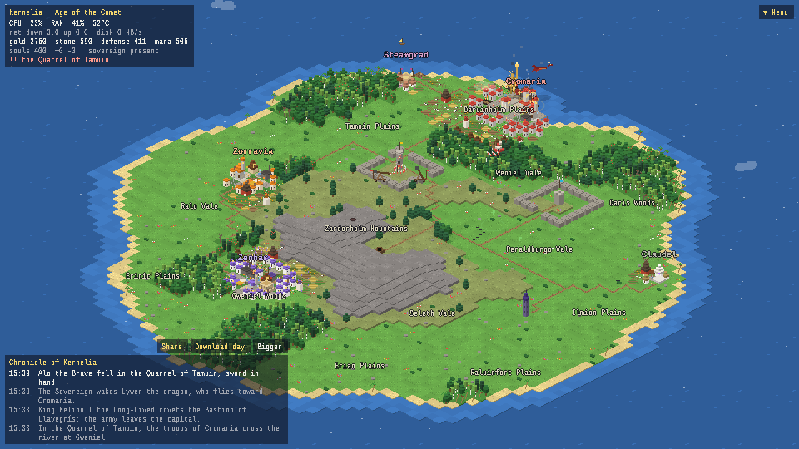
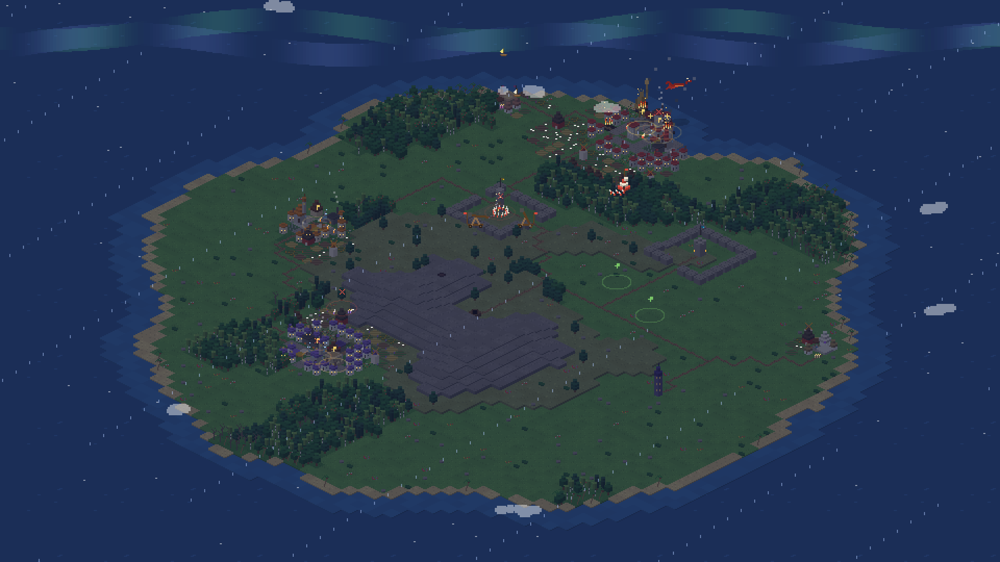
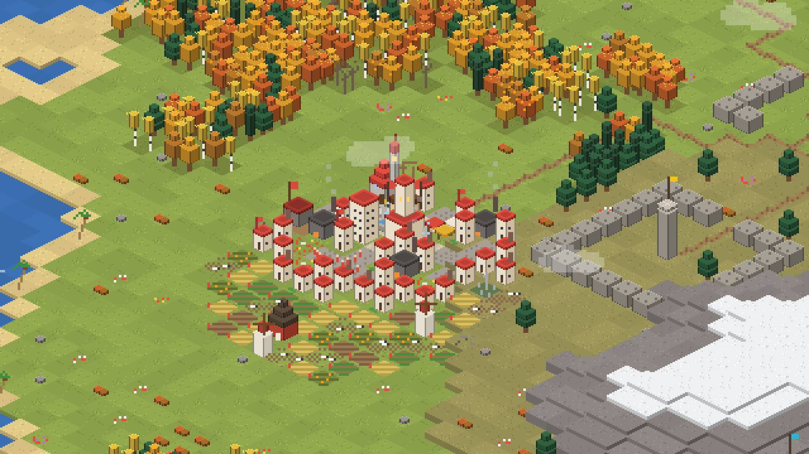

# kernel-kingdom — your computer is a kingdom

A pixel-art isometric **live wallpaper / idle game for Linux (Wayland)** where the
world is built from what your machine is actually doing. Browsers become
empires, containers become citadels, compiling summons thunderstorms, and a
procedural chronicle narrates it all.



*[Leer en castellano](README.es.md) · [Project page](https://rsmedrano-cloud.github.io/kernel-kingdom/)*

## Install (one command)

```bash
curl -fsSL https://raw.githubusercontent.com/rsmedrano-cloud/kernel-kingdom/main/install.sh | bash
```

It installs into `~/.local/share/kernel-kingdom`, links `~/.local/bin/kernel-kingdom`, checks
your system (`kernel-kingdom doctor`) and enables autostart with the session
(`systemd --user`). It needs GTK 4, gtk4-layer-shell and PyGObject from your
distro: if any is missing, the installer shows the exact command and offers to run it
(on Fedora Atomic it layers them with `rpm-ostree`; reboot and run it again).

```bash
kernel-kingdom            # wallpaper on every monitor, in the background (the terminal is free right away)
kernel-kingdom window     # open the window: zoom, powers, realms, chronicle (also from the app launcher)
kernel-kingdom stop       # stop everything
kernel-kingdom story      # the story of the day (.md + .txt)
kernel-kingdom config     # your config: ~/.config/kernel-kingdom/config.toml (language: auto, en, es)
kernel-kingdom update     # get the latest version (your world is kept)
kernel-kingdom uninstall
```

After installing, **Kernel Kingdom** shows up in your applications menu. The world
runs as a background service: closing the window (or the terminal) never stops it.
In the window everything lives under the **Menu** button (top right): which panels
to show, the Sovereign powers and the world actions; the chronicle has its own
**Share** and **Download day** buttons. When a new version is out, the window
tells you and updates itself from **Menu > World > Update**. Big events (wars,
sacked capitals, wonders) also arrive as **desktop notifications**; click one to
fly there (`[notify]` in the config).

**Share your kingdom:** *Share* saves a picture card of the island with the
day's headlines plus the story as Markdown in `~/Pictures/Kernel Kingdom` (IPs
and user names are removed) and copies a short text to the clipboard. Post your
chronicles in [Discussions › Show and tell](https://github.com/rsmedrano-cloud/kernel-kingdom/discussions/categories/show-and-tell)!

## What feeds the world

| Your system | In the kingdom |
|---|---|
| Browser / Electron app (root process + children) | An **empire**: RAM decides how much land it takes, child processes how dense it gets. Real town planning: palace, square, grid streets with wells, market, tavern, temple, barracks, library, workshops, graveyard; farms, pastures with sheep, sawmills and docks on the outskirts; watchtowers on contested borders. |
| Other heavy apps (Claude, terminals, Steam...) | **Hamlets** with a landmark: oracle, smithy, arena, theater, tavern, watchtower... |
| Two realms touching | **Named wars** ("the War of the Orphaned Tabs"): armies march, soldiers clash on the front, trebuchets bombard cities, houses burn, capitals get sacked; then peace treaties. |
| A browser restarts | **Dynasty change**: the monarch dies, abdicates or is overthrown. |
| Containers / databases / daemons | **Citadels, vaults and bastions** whose walls grow with uptime and whose shields block lightning. |
| Editors and compilers | The **Academy** tower: one floor per editor, smoke while compiling. |
| CPU spike | **Thunderstorm**; sustained, the volcano **erupts**. RAM full: **fog**. Swap: **plague**. Hot CPU: **wildfires**. |
| Network / disk | Merchant **fleets** and **caravans**; the **mines** work when the disk does. |
| SSH sessions (`last`) | **Envoys** from a foreign land and an embassy tent on the coast. |
| Reboots / kernel updates | A new **Age**; a new kernel is a new god. |
| You being away | "The Sovereign has left; the realm keeps vigil." |
| Clock and calendar | Day/night with lit windows, and **seasons** for your hemisphere. |

## A world that changes shape during the day

Territory size follows RAM, but **where** a realm lives does not stay put. Each
realm has a heading that slowly turns during the day: it abandons land behind
and settles ahead, so borders migrate across the island. Neighbors go to **war
out of ambition** a few times a day ("over a wedding gone wrong"): armies march,
borders clash, conquered land is razed, and if the attacker reaches the enemy
capital it is **sacked and the court flees**, rebuilding the city elsewhere.
The terrain lives too: forests spread, sawmills cut them, fires leave meadows,
lava hardens into hills. Every install gets its own island.

## The story of the day

Every chronicle entry is archived per day. At midnight (or whenever you press
`e` in the window, or run `kernel-kingdom story`) it is told as a story: a title,
what happened in numbers, the highlights, the day in four parts and its heroes.
You get Markdown and plain text, ready to read aloud or feed to a TTS voice.
[Example of a full day](docs/story-example.md).

On top of that, **heroes** with names and traits are born, do deeds and die;
temples found **religions** with their own deities; treasuries pay for
**monuments**. Villagers have jobs and walk the streets to work, WorldBox-style.

## Watch on the desktop, play in the window

The wallpaper is for watching: clicks go through to your desktop. Open
`kernel-kingdom window` to act:

- **Sovereign powers** (Menu, or keys 1–9): **Lightning**, **Rain**, **Blessing**,
  **Hero**, **Forest**, **Lighthouse**, **Festival**, **Discord**, **Exodus**, and the
  big spenders: **Wonders** (Colossus, Colosseum, Observatory, Hanging Gardens, each
  with an effect and each pricier than the last), a **Dragon** that burns a
  region, **Walls** that make a capital hold most sieges, and **Truce** to end a
  war. Paid with what the kingdom produces (gold, stone, mana, defense); a fat
  treasury attracts pirates. Building takes people and time: workers walk from
  the nearest city to raise your lighthouse or wonder, druids plant the forest
  tile by tile.
- **While you were away**: reopen the window after a while and it sums up what happened.
- **Every realm, living or fallen**, in a scrollable list; click one to fly to its capital.
- **The whole chronicle**: scroll back through history, `c` expands it, PgUp/PgDn.

The map moves on its own too: **explorers** head into the wild and come back with
finds, **armies march** in columns when a war breaks out, and big realms
**besiege fortresses** (the walls hold if you have defense; if not, they fall and
the town is looted).



## Zoom

In window mode: mouse wheel zooms toward the cursor, drag pans, double-click
resets. When zoomed in, sprites are re-rendered at double resolution.



## Light on resources

- Hard cap of 30 FPS; ~6 FPS when nothing is going on.
- Rendered at low resolution, scaled by the GPU with nearest-neighbour filtering.
- **Pauses completely** (0% CPU) when maximized, fullscreen or tiled windows
  cover the wallpaper (COSMIC; other compositors keep it running).
- Measured: ~1–3% of one core while visible, ~2% for the daemon.

## Compatibility

| | |
|---|---|
| COSMIC | everything |
| Sway, Hyprland, KDE Plasma, niri, river | wallpaper works (wlr-layer-shell); automatic pause not yet |
| GNOME, X11 | `kernel-kingdom window` |

Optional: counting keystrokes (just the count, never which keys) needs your user
in the `input` group; otherwise only presence/absence is detected.

## How it works

The Python package is called `reino` (Spanish for *kingdom*; the project started in Spanish).

```
reino/daemon   samples the system (psutil, `last`, Wayland idle), runs the world,
               writes state.json to $XDG_RUNTIME_DIR every 2 s
reino/render   GTK 4 + gtk4-layer-shell; procedural pixel-art sprites (cairo),
               isometric painter, battles and fires, chronicle, Menu
reino/wl.py    tiny pure-Python Wayland client (window coverage, idle)
reino/locales  all text, Spanish and English
```

The world lives in the daemon, so the kingdom keeps evolving even while the
wallpaper is hidden. Tests: `python3 -m unittest discover -s tests`.

## License

MIT
